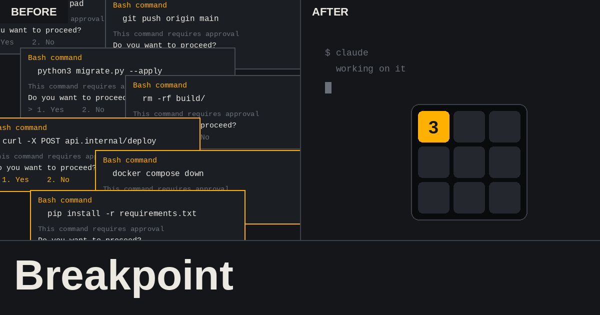

# Breakpoint

A webcam decides when coding agents may interrupt you. Until then their risky requests wait, and you answer them from a keypad.

Built at LauzHack 2026 (EPFL) on Logitech's prototype desk webcam and the MX Creative keypad.



## What it does

- **Agents wait.** Claude Code sessions report to a local hub through hooks. Safe tool calls pass. Risky ones are held until you are free; destructive ones can only be approved in the terminal.
- **The camera reads the desk.** Typing, reading and thinking count as focused. Leaving, a second person looking at the screen, or a phone in hand each change the state. No frame leaves the process.
- **The keypad follows you.** While you work it shows keys for the app in front (notes, chat, search, an agent's terminal). When you review work it shows one key per agent: select one to approve, deny with a spoken reason, stop it, or hand it a photo of a page.
- **Voice with a lip check.** Speech is transcribed on the laptop, and only what was said while your lips moved is kept.
- **Privacy.** The screen is covered when someone else looks at it and when you walk away.

## How it fits together

| Part | Role |
|------|------|
| `hub/hub.py` | Receives hook events, holds and answers tool calls, serves the pages, drives windows |
| `hub/risk.py` | Sorts a tool call into green, amber or red |
| `hub/keypad.html` | Draws the nine keys and reads presses over WebHID |
| `hub/overlay.py` | Screen cover, summary card, page preview |
| `hub/voice.py` | Recording, Whisper transcription, lip gate |
| `sense/` | Face, head pose, owner recognition and the desk view, reduced to one state |
| `game/` | Whack-a-mole on the keys, for a break |

## Run

Linux with X11, Chrome, the webcam and the keypad.

System packages: `xdotool wmctrl x11-utils alsa-utils gnome-terminal xclip python3-tk python3-gi python3-pil python3-aiohttp`.

```
uv sync
bash scripts/get_models.sh
bash scripts/start.sh             # --lock: lock when away (Cinnamon); --keep: keep the agents on the keys
bash scripts/demo_sessions.sh     # three demo Claude Code sessions
bash scripts/stop.sh
```

- Keypad: open `http://localhost:8770/keypad` in Chrome, in one tab, and click Connect keypad.
- Live state: `http://localhost:8770/`. Numbers and the last hour: `/diagnostics`. Infrared view: `/camera`.
- Teach the phone: `uv run python scripts/train_phone.py` (`--clear` to start over).
- Your own project: `python3 scripts/install_hooks.py <project>`, then start `claude` there. With `--observe` it is shown on the keys but never held.
- Agent names on the keys need `ANTHROPIC_API_KEY` in `.env` (see `.env.example`). Without it the folder name is used.
- Keypad access needs a udev rule in `/etc/udev/rules.d/70-mxkeypad.rules`:
  `KERNEL=="hidraw*", ATTRS{idVendor}=="046d", ATTRS{idProduct}=="c354", TAG+="uaccess"`

## Credits

| What | Used for |
|------|----------|
| [mx-creative-console-webhid](https://github.com/mario-gutierrez/mx-creative-console-webhid) (MIT), in `vendor/` | Talking to the keypad from Chrome |
| MediaPipe Face Landmarker and Image Embedder | Face count, head pose, desk view vectors |
| OpenCV SFace | Telling the owner's face from others |
| faster-whisper | Speech to text on the laptop |
| Claude Code hooks, Claude Haiku | Catching tool calls; two-word agent names |
